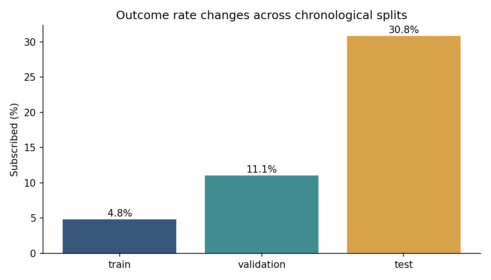
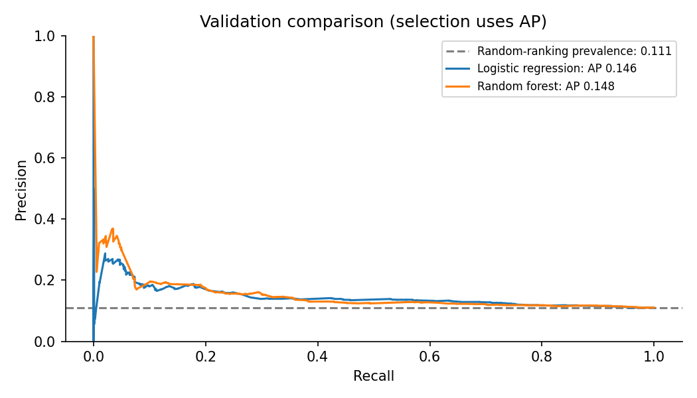

# Marketing Conversion Prediction
## Keisha Walker

Python machine learning research using 41,188 public UCI Bank Marketing records. Compares logistic regression and random forest using ordered train, validation and test blocks, with explicit attention to leakage and changing subscription rates.

## Explore the project
- [Read the case study](Marketing_Conversion_Prediction_Case_Study.pdf)
- [Inspect the Python implementation](marketing_conversion.py)
- [Download the full reproducible project](Marketing_Conversion_Prediction_Keisha_Walker.zip)

The ZIP contains the original script, full dataset, executed walkthrough notebook, tests, saved predictions, metrics, charts and documentation in the required directory structure. **Extract the ZIP to reproduce the complete project.** The files displayed at this repository's top level are a preview, not a replacement for that directory structure.

## Results
| Model / split | Average precision | ROC AUC | Brier score |
|---|---:|---:|---:|
| Logistic regression / validation | 0.1457 | 0.5718 | 0.1020 |
| Random forest / validation | 0.1478 | 0.5610 | 0.1020 |
| Random forest / test | 0.3393 | 0.5376 | 0.2796 |
| Training-rate baseline / test | 0.3083 | 0.5000 | 0.2810 |

The forest narrowly wins validation average precision, but test ranking is weak. Subscription rates change from 4.81% in training to 11.07% in validation and 30.83% in test. Higher test average precision does not establish improvement because prevalence differs.




## Reproduce
Extract the linked ZIP, open a terminal inside its Marketing_Conversion_Prediction folder, then run:

```sh
python3 -m venv .venv
source .venv/bin/activate
python -m pip install -r requirements.txt
python marketing_conversion.py
python -m unittest discover -s tests -v
```

Python 3.12 was tested. The included dataset allows offline analysis after installing dependencies. Re-running the script replaces generated reports.

## Evaluation history and limitations
The final row block was examined in earlier project work. These results are a repeated holdout evaluation, not a new independent test. This script selects using validation average precision; do not tune on the examined test block. No deployment, incremental campaign revenue, causal uplift, or fairness validation is claimed. Scores severely underpredict later subscription rates.

Implementation extensions and documentation were prepared with AI assistance; the user's original Steps 1–6 script is preserved in the full package. The project is an educational research demonstration, not a production targeting system.

## Data attribution
Moro, S., Rita, P., & Cortez, P. (2014). Bank Marketing. UCI Machine Learning Repository. https://doi.org/10.24432/C5K306. CC BY 4.0. See [data attribution](DATA_ATTRIBUTION.md).
